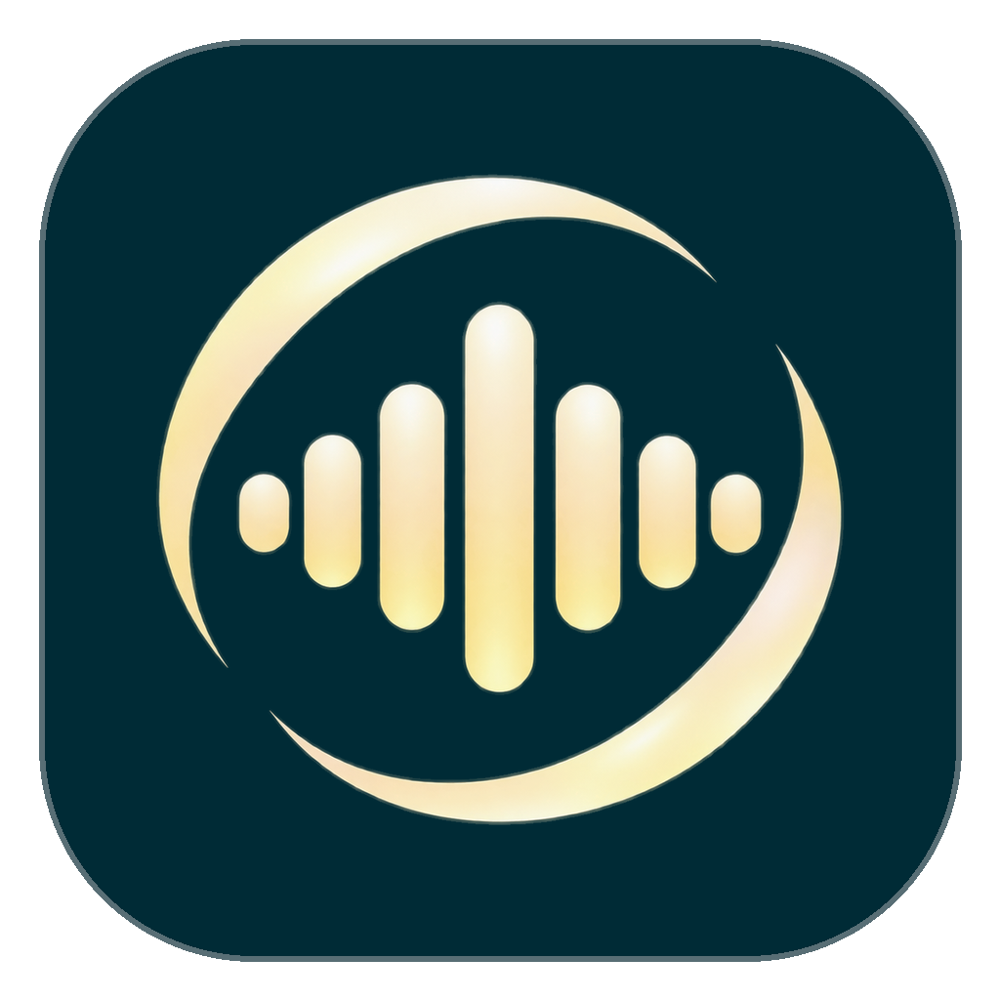
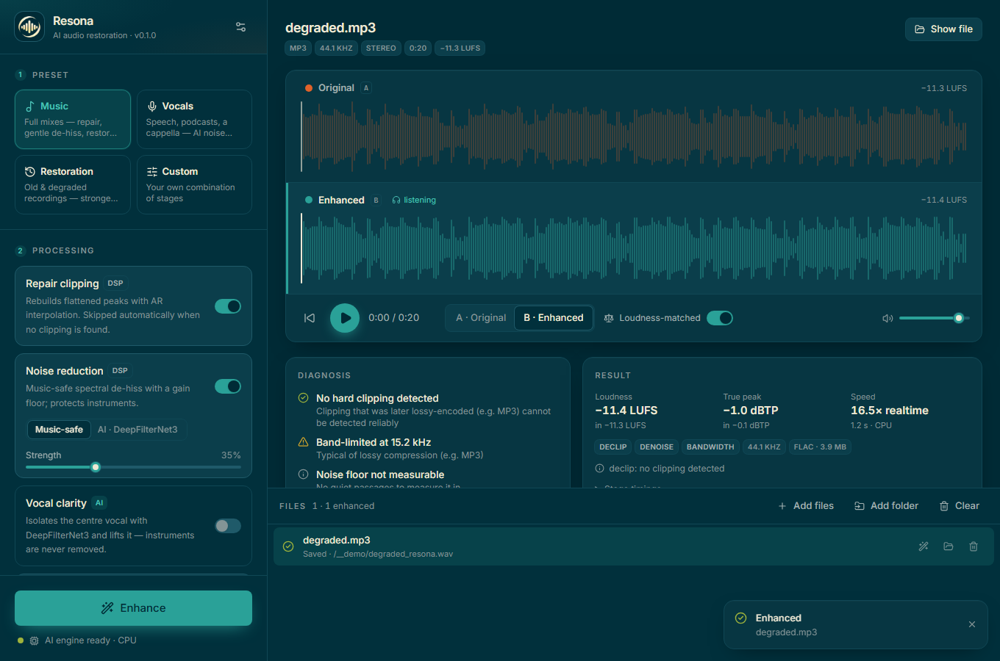
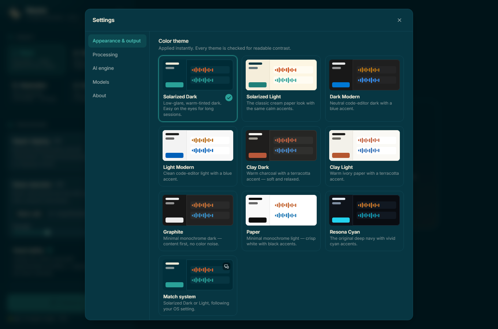

<p align="center">
  
</p>

<h1 align="center">Resona</h1>

<p align="center">
  <b>Free, open-source AI audio restoration for music, vocals and recordings.</b><br/>
  Runs entirely on your computer — no account, no subscription, no cloud.
</p>

<p align="center">
  <a href="LICENSE"></a>
  <a href="https://github.com/Layfate/Resona/releases/latest"></a>
  <a href="https://github.com/Layfate/Resona/actions/workflows/ci.yml"></a>
  
</p>

<p align="center">
  <a href="https://github.com/Layfate/Resona/releases/latest"><b>⬇ Download for Windows, macOS and Linux</b></a>
</p>

<p align="center">
  
</p>

Resona is a desktop app in the spirit of [Upscayl](https://github.com/upscayl/upscayl), built for sound instead of images. Drop in a song, a voice memo or an old recording. Resona finds the problems (clipping, codec band-limiting, noise), repairs what it can, and lets you A/B the result against a loudness-matched original before you export.

> **Honest by design.** No software can recover information that lossy compression or clipping destroyed. Resona *estimates* plausible content and says so. Every feature below is labelled **working**, **experimental** or **planned**. Nothing is presented as more than it is.

---

## Contents

- [Features](#features)
- [Install](#install)
- [Using Resona](#using-resona)
- [How it works](#how-it-works)
- [Models and licences](#models-and-licences)
- [Performance](#performance)
- [Limitations](#limitations)
- [Development](#development)
- [Roadmap](#roadmap)
- [Contributing](#contributing) · [Licence](#licence) · [Acknowledgements](#acknowledgements)

## Features

### Status at v0.1.0

| Feature | Status | What it is |
|---|---|---|
| **AI noise reduction** | ✅ Working | [DeepFilterNet3](https://github.com/Rikorose/DeepFilterNet) (pretrained, 48 kHz full-band) through a NumPy + ONNX Runtime port. It is verified sample-by-sample against the official PyTorch implementation. Best for speech and vocals. |
| **Music-safe noise reduction** | ✅ Working | Spectral de-hiss with a global noise profile, decision-directed Wiener gains, a gain floor, and gains linked across L/R. It protects instruments (DSP, not ML). |
| **Declipping** | ✅ Working | Detects flattened peaks and rebuilds them with least-squares AR interpolation under a consistency constraint. Works on lossless clipped audio (WAV/FLAC). |
| **Bandwidth extension ("upscaling")** | ✅ Working (DSP) | Detects codec or low-sample-rate cut-offs. It then synthesises the missing top octave with phase-coherent spectral band replication (the HE-AAC/SBR technique). Low-rate files are upsampled to 48 kHz. **This is not a neural super-resolution model** (see the [roadmap](#roadmap)). |
| **Vocal clarity** | 🧪 Experimental | Uses DeepFilterNet3 to estimate the centre vocal and lifts it by a few dB. Instruments are never removed. Not yet evaluated on a large music test set. |
| **Before/after comparison** | ✅ Working | Two synchronised waveforms with instant, sample-aligned A/B switching (`A`/`B`/`Tab`). Includes a **loudness-matched** mode, so you hear the processing rather than a volume change. |
| **Loudness and peak safety** | ✅ Working | ITU-R BS.1770-4 loudness. The output matches the original's integrated loudness (or a target you choose). A look-ahead true-peak limiter keeps output below −1 dBTP. Duration and channel alignment are preserved exactly. |
| **Presets** | ✅ Working | Music, Vocals, Restoration and Custom. |
| **Batch processing** | ✅ Working | Queue any number of files or folders, with per-file progress and cancel/cancel-all. Cancelling kills the worker immediately and removes partial files. |
| **Export** | ✅ Working | WAV, FLAC, AIFF (16/24/32-bit, TPDF-dithered 16-bit), MP3, Ogg Vorbis and Opus with no extra tools (all tested). |
| **FFmpeg formats** | 🧪 Implemented, CI-tested only | AAC/ALAC (`.m4a`) export, exact-bitrate LAME MP3, and decoding of M4A/WMA/etc. through an FFmpeg you install. These paths run in Linux CI; they were not run on the Windows development machine. |
| **Long files** | ✅ Working | Overlapping chunked processing with warm-up context and seamless crossfades. |
| **Models: download, cache, verify** | ✅ Working | Pinned immutable URLs, SHA-256 checks of each archive *and* every file, and safe extraction. |
| **GPU acceleration** | 🧪 Experimental | NVIDIA (CUDA) and DirectML engines install and run. For the current model, the **CPU is as fast or faster** ([measurements](#performance)), so CPU is the default. Apple Core ML is included in the CPU engine on macOS (untested). |
| **Themes** | ✅ Working | Solarized Dark (default), Solarized Light, Dark/Light Modern, Clay Dark/Light, Graphite, Paper and Resona Cyan, plus Match System. Every theme is contrast-tested. |
| **Platforms** | ⚠️ Partially verified | Built and tested on **Windows 11**. macOS (Apple Silicon and Intel) and Linux builds are produced by CI but **have not been verified by hand yet**. |

### UI

- Drag and drop files or whole folders, or use the file browser.
- Automatic diagnosis of each file: clipping, band-limit frequency, loudness, true peak and noise floor.
- Interactive waveforms (click or drag to seek) and an average-spectrum chart, original vs enhanced, with a table view.
- Keyboard: `Space` play/pause, `A`/`B` or `Tab` to switch versions, `←`/`→` to seek 5 s.

<p align="center">
  
</p>

## Install

Download the installer for your platform from the [Releases](https://github.com/Layfate/Resona/releases/latest) page:

| Platform | File |
|---|---|
| Windows 10/11 (x64) | `Resona_0.1.0_x64-setup.exe` (NSIS) or `Resona_0.1.0_x64_en-US.msi` |
| macOS 11+ (Apple Silicon) | `Resona_0.1.0_aarch64.dmg` |
| macOS 11+ (Intel) | `Resona_0.1.0_x64.dmg` |
| Linux (x64) | `.AppImage`, `.deb` or `.rpm` |

The installers are **not code-signed yet**. Windows SmartScreen will ask you to confirm with *More info → Run anyway*. On macOS, right-click the app and choose *Open* the first time.

### First start: the AI engine

The installer is small because the processing engine is installed separately. On first launch, Resona offers to set it up:

| Engine | Size on disk | Notes |
|---|---|---|
| **CPU** (recommended) | ≈ 320 MB (≈ 100 MB download) | Works everywhere and is the fastest choice for today's models. Includes Core ML on macOS. |
| NVIDIA CUDA | ≈ 2.1 GB | Windows/Linux. Includes the CUDA and cuDNN runtimes as wheels, so only a recent NVIDIA driver is needed. |
| DirectML | ≈ 360 MB | Windows, any DirectX 12 GPU. Experimental and slow for the current model. |

Setup downloads a pinned, checksum-verified [`uv`](https://github.com/astral-sh/uv). That installs a private Python 3.12 and the libraries into Resona's own data folder. **Your system Python is never touched**, and removing the engine deletes only that folder. The 8 MB DeepFilterNet3 model is then downloaded and verified. After that, everything works offline.

Optional: install [FFmpeg](https://ffmpeg.org/) (or point Settings → AI engine at it) for AAC/ALAC export and decoding of formats such as M4A or WMA. With FFmpeg present, MP3 export uses LAME at the exact bitrate you choose.

## Using Resona

1. **Add audio**: drop files or folders, or click *Browse*. Each file is analysed automatically.
2. **Pick a preset**:
   - **Music**: repair clipping, gentle music-safe de-hiss, restore the top octave.
   - **Vocals**: AI noise removal for speech, podcasts and a cappella.
   - **Restoration**: stronger repair for old or degraded recordings.
   - **Custom**: change any stage. Stages are labelled `AI` or `DSP`.
3. **Choose the output**: format, quality and folder. Originals are never overwritten.
4. **Enhance**: one file, or *Enhance all* for the whole list.
5. **Compare**: switch between A and B while playing. Keep *Loudness-matched* on for a fair comparison.

## How it works

```
┌────────────── Resona (Tauri 2) ──────────────┐        ┌──────── Python worker (one process per job) ───────┐
│ React + TypeScript UI  ── IPC ──►  Rust core │ spawn  │ decode → declip → resample → analyse               │
│  • WaveSurfer waveforms           • settings │──────► │   → [chunked] denoise → vocal → bandwidth ext.     │
│  • Web Audio A/B player           • job queue│ JSONL  │   → loudness match → true-peak limit → encode      │
│  • themes, dialogs                • engine   │◄────── │ NumPy · SciPy · libsndfile · ONNX Runtime          │
└──────────────────────────────────────────────┘ events └────────────────────────────────────────────────────┘
```

- **No audio is processed in the UI process.** Each job runs in its own worker process and reports progress as JSON lines. Cancelling kills that process, which also frees all CPU/GPU memory.
- **Global analysis, chunked processing.** The noise profile, cut-off frequency and loudness are measured once for the whole file. Processing then runs in overlapping chunks, so memory stays bounded and parameters never drift between chunks.
- **Safe output.** Output is written to a temporary file and atomically renamed on success.

Full detail: [docs/ARCHITECTURE.md](docs/ARCHITECTURE.md).

## Models and licences

| Model | Task | Licence | Source | Size |
|---|---|---|---|---|
| DeepFilterNet3 (ONNX export, 2023-05-23) | Noise suppression, vocal estimate | MIT OR Apache-2.0 | [Rikorose/DeepFilterNet](https://github.com/Rikorose/DeepFilterNet) @ `84d57ec` | 8.0 MB |

Provenance, checksums and the porting/verification process are in [docs/MODELS.md](docs/MODELS.md). Third-party software licences are in [THIRD_PARTY_NOTICES.md](THIRD_PARTY_NOTICES.md).

## Performance

Measured on an AMD Ryzen 7 5700X (8 cores), 32 GB RAM, RTX 4060, Windows 11. Synthetic stereo music at 44.1 kHz, `python -m resona_worker bench`:

| Stage | Speed (× real time) |
|---|---|
| DeepFilterNet3, CPU (ONNX Runtime 1.32) | ≈ 32× |
| DeepFilterNet3, CUDA (RTX 4060) | ≈ 30× |
| DeepFilterNet3, DirectML (RTX 4060) | ≈ 2× |
| Music-safe de-hiss | ≈ 127× |
| Bandwidth extension | ≈ 95× |
| Declipping | ≈ 680× (depends heavily on the amount of clipping) |
| Loudness (BS.1770) / true-peak limiter | ≈ 560× / 170× |
| Full *Music* preset, 20 s MP3 → FLAC (incl. decode/encode) | ≈ 16× |

DeepFilterNet3 is a small recurrent network (about 12,000 sequential GRU steps for 2 minutes of audio), so GPUs bring no benefit today. The GPU engines exist for larger models on the roadmap. Run the benchmark on your own machine via *Settings → About → Run benchmark*.

## Limitations

- **Lost information stays lost.** Bandwidth extension *synthesises* high frequencies from the octave below. It sounds like "air", but it is not the original recording's content.
- **Heavy clipping is only partly repaired.** Light clipping (peaks cut by about 1–2 dB) is rebuilt closely. When peaks were cut by 4 dB or more, the declipper still removes the flat tops, but on dense music the waveform it rebuilds is only slightly closer to the original. Speech holds up better.
- **Clipping hidden by lossy encoding** (a clipped master that was later saved as MP3) cannot be detected reliably, because encoder ripple breaks the flat tops. Declipping is reliable on WAV/FLAC.
- **DeepFilterNet3 is trained on speech.** On full mixes it treats instruments as noise, so the *Music* preset uses the music-safe DSP denoiser by default.
- **Vocal clarity** assumes a centred lead vocal and is experimental.
- The **noise floor** is only reported when a recording has genuinely quiet passages.
- **Very long files** (over about 25 minutes) are compared with streaming playback instead of sample-accurate buffers, to save memory.
- **macOS and Linux** builds are not yet hand-verified. GPU support on AMD/ROCm and Apple Core ML is untested.

## Development

```bash
# Prerequisites: Node 20+, Rust (stable), Python 3.10–3.12 or uv, platform deps for Tauri 2
npm install
uv venv worker/.venv --python 3.12 && uv pip install --python worker/.venv -r worker/requirements/dev.txt
npm run tauri dev              # the debug build finds worker/.venv automatically
```

Tests: `npm test` (frontend), `cd worker && pytest` (DSP, model, CLI end-to-end), `cd src-tauri && cargo test` (backend, including a headless end-to-end queue test). More in [docs/DEVELOPMENT.md](docs/DEVELOPMENT.md), including a browser preview mode for UI work.

## Roadmap

- **Neural super-resolution** for music: evaluate [AudioSR](https://github.com/haoheliu/versatile_audio_super_resolution) (MIT code; weight licence to confirm) and [Apollo](https://github.com/JusperLee/Apollo) (CC BY-SA 4.0) as an optional PyTorch engine, where the GPU engines will finally pay off.
- **Stem-aware vocal enhancement** with [Demucs](https://github.com/facebookresearch/demucs) (MIT): separate, enhance the vocal stem only, remix.
- Declipping for lossy-encoded clipping.
- Hand-verified macOS/Linux releases, code signing and an auto-updater.
- Region looping and zoom in the comparison view.

## Contributing

Contributions are welcome. See [CONTRIBUTING.md](CONTRIBUTING.md). Please keep the honesty rule: a feature is only *working* when it is tested.

## Licence

Resona is released under the [MIT Licence](LICENSE). Downloaded models keep their own licences (see [docs/MODELS.md](docs/MODELS.md)).

## Acknowledgements

[DeepFilterNet](https://github.com/Rikorose/DeepFilterNet) by Hendrik Schröter et al. · [Tauri](https://tauri.app) · [ONNX Runtime](https://onnxruntime.ai) · [libsndfile](https://libsndfile.github.io/libsndfile/) · [WaveSurfer.js](https://wavesurfer.xyz) · [uv](https://github.com/astral-sh/uv) · the [Solarized](https://ethanschoonover.com/solarized/) palette by Ethan Schoonover · inspired by [Upscayl](https://github.com/upscayl/upscayl).
